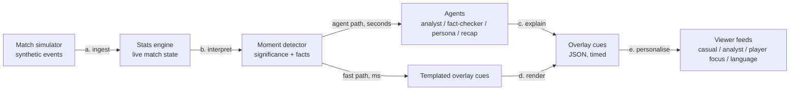

# MatchLens

**Explainable, personalised match intelligence for live football.**

MatchLens ingests a live stream of synthetic football events and turns it into insights that explain *why* a moment matters, timed overlay cues a broadcast graphics engine can render, and recaps. The same intelligence is presented differently for an analyst, a casual fan, or someone following one player all match.

Built for the *Inside the Game* developer hackathon (challenge: *The Synthetic Match Insights Engine*). All data is synthetic. The clubs and players are fictional.

## The pipeline



| Stage | What happens | Where |
|---|---|---|
| a. Ingest | Events arrive one at a time: passes, carries, dribbles, shots, pressure, tackles, interceptions, possession changes, set pieces, sprints, physical tracking and match metadata | `simulator.py`, `replay.py` |
| b. Interpret | Deterministic stats on every event: pass length, accuracy and **0–10 pass difficulty**, expected completion, ball and shot speed, xG, threat added, possession, field tilt, PPDA, momentum and a **control-vs-chaos index** | `stats.py`, `geometry.py` |
| c. Explain | A moment detector scores significance and attaches the **facts** that justify it (for example "pass difficulty 8.6/10, 2 opponents in the lane, 34% expected completion") | `moments.py` |
| d. Render | Timed, machine-readable overlay cues with a JSON Schema: template, screen region, start, duration, priority. A scheduler stops two cues fighting over one region. | `overlays.py`, `schemas/` |
| e. Personalise | Viewer profiles cover mode (casual, analyst, player focus), favourite club and players, focus metric and locale. Relevance scoring decides what each viewer sees. | `personas.py`, `pipeline.py` |

**Two speeds.** The templated fast path means the screen never waits on a model. The agent layer (in progress) enriches the same moments a few seconds later. If an agent is slow or fails, viewers still get the templated cue.

## Quickstart

```bash
python -m venv .venv
.venv/Scripts/activate        # Windows; use `source .venv/bin/activate` elsewhere
pip install -e ".[dev]"

matchlens ticker --seed 2 --mode casual                        # live overlay feed for a casual fan
matchlens ticker --seed 2 --mode analyst                       # same match, analyst wording and metrics
matchlens ticker --seed 2 --mode player_focus --player KBY-07  # follow one player all match
matchlens ticker --seed 2 --speed 60                           # replay at 60x (one match minute per second)
matchlens stats --seed 2                                       # box score and leaders
matchlens simulate --seed 2                                    # write data/samples/SYN-00002.jsonl
matchlens schema --out schemas                                 # export JSON Schemas for the contracts
matchlens calibrate                                            # realism check over 30 matches
pytest
```

Sample output (casual mode):

```
    50'  [moment_card   ] GOAL! - Zane Mbeki-Foster scores! Ironvale Athletic are in front! Set up by Felix Marangoni. KBY 0-1 IRV
    59'  [moment_card   ] GOAL! - Rafe Delacroix scores! That's the equaliser! Set up by Sid Abernethy. KBY 1-1 IRV
    61'  [player_tag    ] Okonkwo-Reyes - Brilliant pass! Threaded past 1 defender.
```

The same moments in analyst mode:

```
    18'  [player_tag    ] Thwaite - Pass difficulty 8.6/10 | 57.7 m | 34% expected completion
    28'  [stat_bar      ] Game rhythm - Chaos index 65 | 3.2 turnovers/min | 81% passing
```

## Synthetic data that behaves like football

The simulator is a possession-chain model. Whoever has the ball picks an action based on pitch position, the pressure on them (from modelled opponent positions and team pressing intensity) and their team's style. Outcomes come from player attributes and geometry. Each team's intensity drifts and reacts to the score, which produces momentum swings and pressure spells. The same seed always gives the same match.

Averaged over 30 simulated matches (`matchlens calibrate`), per team:

| Metric | Simulated mean | Typical top-flight range |
|---|---|---|
| Goals | 1.75 | 1.0–1.8 |
| Shots / on target | 14.1 / 5.1 | 10–16 / 3–6 |
| Passes | 430 | 380–620 |
| Pass accuracy | 79% | 78–88% |
| Corners | 6.4 | 4–7 |
| Fouls / yellow cards | 10.0 / 1.95 | 9–13 / 1–2.5 |
| Tackles won | 18.0 | 12–20 |
| Actions under pressure | 17% | 15–30% |
| Top distance covered | 12.2 km | 11–13 km |

Event coordinates are metres on a 105 x 68 pitch in the acting team's frame (attacking towards x = 105). `schema.to_absolute()` converts them to a fixed broadcast frame.

## Explainable models

Every number shown to a viewer comes from a transparent formula in `geometry.py` and `stats.py`:

- **xG**: logistic on shot distance and goal-mouth angle, with header and pressure adjustments (about 0.27 from the penalty spot).
- **Pass difficulty (0–10)**: pass length, opponents in the passing lane, pressure on the passer, forward progress, and pass type (through ball, cross, long ball). It maps to an expected-completion probability, giving **passes over expected** per player.
- **Momentum**: decayed attacking threat (threat added plus xG) for each side, from -1 to 1.
- **Control vs chaos**: turnovers per minute, pass completion and duels per minute over the last 5 minutes, labelled *Controlled*, *Contested* or *Chaotic*.
- **Field tilt and PPDA**: share of final-third touches, and opponent passes allowed per defensive action.

## Repository layout

```
src/matchlens/
  schema.py      data contracts: Event, Moment, Fact, OverlayCue
  squads.py      fictional clubs, players and formations
  simulator.py   synthetic match generator
  geometry.py    pitch geometry, xG, threat, pass difficulty
  stats.py       live match state and derived metrics
  moments.py     moment detection with evidence
  overlays.py    fast-path overlay cues and region scheduler
  personas.py    viewer profiles and relevance
  pipeline.py    wires the stages together
  replay.py      JSONL I/O and real-time replay
  calibrate.py   realism check against real-world ranges
  cli.py         command line
schemas/         JSON Schemas for the contracts
data/samples/    a sample match stream
tests/
```

## Roadmap (hackathon week)

- [x] Synthetic match simulator, calibrated
- [x] Stats engine, moment detector, fast-path overlay cues, viewer profiles
- [ ] Agents on Microsoft Foundry with Microsoft Agent Framework: analyst, fact-checker, persona and multilingual, recap
- [ ] FastAPI service with real-time push (Azure Web PubSub) and a React overlay demo on a pitch view
- [ ] Azure deployment: Event Hubs ingest, Container Apps, Cosmos DB, Application Insights, `azd up`
- [ ] Stretch: auto-eventing from video, voice commentary with Azure AI Speech
